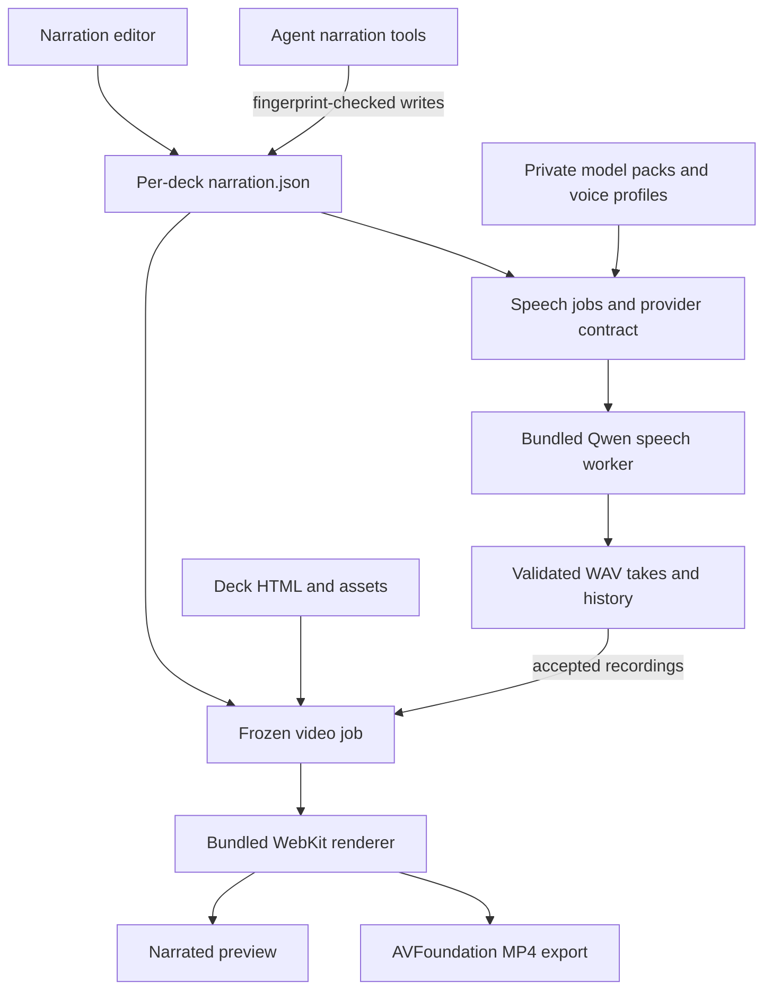

# Narration: implementation and research background

SlopSlide stores per-slide scripts and accepted recordings beside each deck, generates local speech with Qwen3-TTS 0.6B, and supports saved presenters, recording history, narrated preview and MP4 export. Native speech and video helpers currently target macOS; other platforms can edit scripts. The [speech connector guide](../src-tauri/speech-connector/README.md) documents the provider interface and opt-in model tests.

## Architecture

The React editor and agent tools share the same versioned narration manifest. Agent writes carry the last-read fingerprint; audio acceptance also checks that the source settings still match. Failed or cancelled generation keeps previous recordings available.

The Tauri host owns deck storage, jobs, cancellation and acceptance of generated audio. The [speech connector](../src-tauri/speech-connector/README.md) owns provider capabilities, model verification, worker reuse and voice profiles; its library and CLI do not depend on Tauri. Model packs and personal references stay in private app data. Scripts and generated recordings live beside `deck.html`; another HTML filename gets its own `<filename>.slopslide/` directory.

Video preparation freezes the deck, settings and accepted audio, then renders static slide images for preview and encoding. Later edits enter the video only after preparing it again. Hidden slides are excluded; blank scripts use timed silence. Animation and embedded media are flattened, and embedded sound is excluded.

Speech synthesis runs locally after model setup. Agent drafting uses the configured chat provider and is a separate operation.

## Research behind the implementation

The October 8–11, 2026 investigation compared native CPU speech configurations with the official Python reference, auditioned English/German stock and cloned voices, measured memory and resident-worker reuse, and prototyped WebKit rendering and AVFoundation encoding. The selected prototype uses BF16 CPU inference with `QWEN_NO_KLEIDI=1`, a reusable worker, Sonic pacing, and a separate Base model pack for personal voices. Listening accepted the tested German reference and usable English output with a slight accent; this is limited evidence, not broad voice-quality or hardware qualification.

The complete research, measurements, recordings, mockups and implementation logs remain in commit [`9e8d2235`](https://github.com/the-ulib/slop-slides/tree/9e8d2235d23b74ce6b0bfbee2c4fff6a9990be14). They were removed from the current tree to keep the product change reviewable:

- [Feasibility findings](https://github.com/the-ulib/slop-slides/blob/9e8d2235d23b74ce6b0bfbee2c4fff6a9990be14/docs/narration-feasibility.md), including configuration comparisons and listening conclusions.
- [Reproduction probes](https://github.com/the-ulib/slop-slides/tree/9e8d2235d23b74ce6b0bfbee2c4fff6a9990be14/dev/feasibility) and [raw evidence](https://github.com/the-ulib/slop-slides/tree/9e8d2235d23b74ce6b0bfbee2c4fff6a9990be14/docs/feasibility).
- [Implementation and packaged-app smoke records](https://github.com/the-ulib/slop-slides/tree/9e8d2235d23b74ce6b0bfbee2c4fff6a9990be14/docs/implementation), covering persistence, cancellation, voice reuse and narrated export.

Only the audio required by opt-in regression tests remains under [fixtures/narration](../fixtures/narration/README.md).

## Build and remaining qualification

Run `./check.sh` for automated checks. Native model tests are opt-in and require the pinned packs; ordinary checks do not establish speech quality or installer readiness. Release jobs use a native runner for each Mac architecture. Helper scripts reject a Tauri target that differs from the host instead of bundling incompatible executables; cross-architecture and universal helper builds are not supported.

Before distribution, verify the contained app's strict signature and notarization, complete dependency-license/notice aggregation (including the recorded Kleidi provenance discrepancy), and perform a clean-install test. The earlier local DMG's original app did not pass strict signature verification; a separately re-signed copy was used for smoke testing. Broad device/memory coverage, full-app sandbox/App Store qualification, non-macOS native helpers, cloud providers and a speech MCP adapter remain follow-ups.
